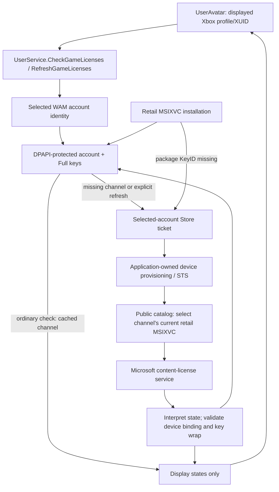

# Preview-build license checking: technical reference

**Reviewed:** 2026-10-25. **Upstream:** [LiteLDev/LeviLauncher](https://github.com/LiteLDev/LeviLauncher).

This is a source-level review of the latest published launcher prerelease and the latest successful `main` CI build available on the review date. It describes Minecraft account authorization, not the launcher's GPL software license. It also distinguishes the launcher's preview distribution from the **Minecraft Preview** game channel.

No Microsoft account credentials, private license documents, content keys, or live entitlement responses were collected for this review. No launcher/game binary was executed. Server-side Microsoft licensing policy is outside the repository and cannot be established from this source alone.

## Contents

1. [Summary](#1-summary)
2. [Exactly which builds were reviewed](#2-exactly-which-builds-were-reviewed)
3. [Architecture and entry points](#3-architecture-and-entry-points)
4. [Microsoft account identity and sign-in](#4-microsoft-account-identity-and-sign-in)
5. [The two-channel checking algorithm](#5-the-two-channel-checking-algorithm)
6. [Microsoft service requests](#6-microsoft-service-requests)
7. [License interpretation and key validation](#7-license-interpretation-and-key-validation)
8. [Persistent cache, account switching, and offline behavior](#8-persistent-cache-account-switching-and-offline-behavior)
9. [Download, installation, and launch boundaries](#9-download-installation-and-launch-boundaries)
10. [Errors, timeouts, and cancellation](#10-errors-timeouts-and-cancellation)
11. [Security properties and limitations](#11-security-properties-and-limitations)
12. [Troubleshooting without exposing secrets](#12-troubleshooting-without-exposing-secrets)
13. [Validation and test coverage](#13-validation-and-test-coverage)
14. [Implementation history](#14-implementation-history)
15. [Pinned source references](#15-pinned-source-references)

## 1. Summary

- Signing into Xbox is **not** itself treated as proof of a Minecraft license.
- The launcher queries Microsoft for **Release** and **Preview** separately. It does not infer Preview access from Release access, or vice versa.
- For an uncached channel, it finds an eligible current x64 MSIXVC package in Microsoft's public catalog, requests its content license using the selected Microsoft account and an application-owned device, and validates the returned usable keys.
- The frontend receives only `{xuid, release, preview}` display states. Tokens and content keys stay in the backend.
- Verified `Full` keys are saved in a Windows DPAPI-protected account record. An ordinary check can reuse them; explicit refresh queries both channels online.
- Cache entries have **no timestamp, expiration, or periodic online revalidation**. Consequently, an `Authorized` badge is not necessarily a fresh or permanent ownership determination.
- Retail GDK/MSIXVC installation requires an appropriate usable full-license content key, independently of the badge. The common launch function does not call this license checker before every launch.

These statements follow from [the entitlement checker][entitlements], [the cache][cache], [the installer][install], and [the frontend][avatar].

## 2. Exactly which builds were reviewed

| Item | Evidence |
| --- | --- |
| Latest published GitHub prerelease | [`v1.0.3`](https://github.com/LiteLDev/LeviLauncher/releases/tag/v1.0.3), published **2026-09-22 08:38:46 UTC**, GitHub `prerelease: true` |
| Commit behind the annotated release tag | `56768d5823750153380ba12adc064042bbf338f6` |
| Latest successful `main` build | [Actions run `40056452733`](https://github.com/LiteLDev/LeviLauncher/actions/runs/40056452733), created **2026-10-24 02:59:28 UTC**, completed successfully by **03:10:41 UTC** |
| CI source commit / reviewed checkout | `1932a23238b2f99c4c80571d1ab2ea49369f8045` |
| CI standalone artifact | `LeviLauncher.exe`, artifact ID `12545628177`, 32,259,584 bytes; API-reported digest `sha256:3215b67e17d3f47ecc23c6f24ab3f9c879d4d440ff5ed90c0b83adbe1e3d6225` |
| CI installer artifact | `LeviLauncher-amd64-installer.exe`, artifact ID `12545912252`, 38,452,458 bytes; API-reported digest `sha256:e4d8ebf5e8e949d4d5e88dc5061486c9e90b1e7374334958968e4f68b319e3e8` |

The release's standalone executable has API-reported SHA-256 `37f2091c4d1b10d8cba73a814e64ca5537e237d46171ca7369a364277f56e7ca`; its installer has `668bdbc6c699def53de5509e6ede41aaedaa982197b2ca69733858e9b3dcc025`. These are provenance metadata, **not locally verified binary hashes**: the binaries were not downloaded for this review. CI artifacts were not expired when inspected; their availability is subject to GitHub retention.

There is **no dedicated `preview` branch** in the upstream branch listing. The inspected branches were `main`, `v1`, and `mods-at-levimc-org`. The [build workflow][workflow] builds branch pushes and pull requests; tagged pushes can additionally publish releases. A successful newer branch artifact is not a separately tagged release.

The current `build/config.yml` identifies version `1.0.3` and has `beta: "false"`, while the published release is marked prerelease by GitHub. Use the release API's actual flag to describe the published release, rather than inferring it from today's config.

The following comparison returned **no changes** in the reviewed licensing/identity paths between the release tag and the newer CI commit:

```powershell
git diff --name-only v1.0.3 1932a23238b2f99c4c80571d1ab2ea49369f8045 -- `
  internal/nativeinstall internal/xbox internal/app/service_user.go `
  internal/mcservice/installer.go internal/mcservice/uwp_install.go `
  internal/versionlaunch/launcher.go frontend/src/components/UserAvatar.tsx
```

Accordingly, the licensing behavior below applies to both source snapshots. Source references are pinned to the newer CI commit, not a moving branch.

## 3. Architecture and entry points



| Component | Responsibility |
| --- | --- |
| [`UserAvatar.tsx`][avatar] | Resolve Xbox identity, start automatic checks, refresh, display channel states, cancel obsolete requests |
| [`service_user.go`][service] | Wails service boundary; pass displayed XUID and the shared account-cache directory |
| [`auth_windows.go`][auth], [`wam_windows.go`][wam] | Selected-account WAM tokens, Xbox identity, same-account enforcement |
| [`account_selection_windows.go`][selection] | Restore and transactionally save selected account; revision/selection epoch |
| [`entitlements_windows.go`][entitlements] | Public catalog lookup, channel-state checking, normal/forced refresh |
| [`device_windows.go`][device], [`rst_windows.go`][rst] | Application-owned device registration and Microsoft STS tickets |
| [`license_windows.go`][license], [`extract_windows.go`][extract] | Content-license request/parsing, device binding, key unwrap, package extraction |
| [`license_cache_windows.go`][cache] | Account-bound full-key cache, restore, channel invalidation |
| [`installer.go`][installer] | Retail GDK installation policy: `RequireFullLicense: true` |

There are two distinct account identifiers:

- **XUID:** Xbox user identifier displayed in the UI and echoed in the result.
- **WAM AccountID:** Windows authentication-provider account reference used for token selection and protected cache ownership.

They are checked against the authenticated session; they are not assumed interchangeable.

## 4. Microsoft account identity and sign-in

### Startup and explicit selection

`NewUserService` calls `RestoreSharedAccount` before avatar or installation requests can select an account. Restoration loads the saved **identity**, not an OAuth/Store credential. Missing selection means first use requires explicit sign-in. An unreadable/corrupt saved selection blocks automatic fallback to Windows' default account. See [service][service] and [selection][selection].

`SignInSharedAccount` performs a transaction:

1. Open native WAM authentication for the launcher window.
2. Obtain an Xbox-scope WAM ticket.
3. Exchange it at `user.auth.xboxlive.com`, then obtain an XSTS session from `xsts.auth.xboxlive.com`.
4. Persist the selected WAM account identity and associated cache record.
5. Only after all of this succeeds, replace the in-memory selected profile/session.

A dismissed prompt, failed token exchange, cancellation, or persistence failure leaves the previous account selected. Switching to another account replaces the protected account record and removes the previous account's cached keys. Re-selecting the same valid account can retain its keys. See [authentication][auth] and [selection][selection].

### Latest prerelease's administrator-mode fix

In a normal process, interactive sign-in first uses the Windows account/provider selection UI. In an elevated process, it instead finds the Microsoft provider and uses `RequestTokenForWindowAsync` directly; the account pane can close across the elevation boundary.

The initial request uses the default prompt to retain single sign-on. If an interactive window-scoped request returns `UserInteractionRequired` without presenting the UI, it is retried once with `ForceAuthentication`. Silent background requests **never** acquire this retry dialog; dismissal and ordinary provider failure do not trigger it. This is the main authentication change shipped in `v1.0.3`. See [WAM implementation][wam].

### Binding a check to the displayed user

`beginLicenseAccount(ctx, expectedXUID)` obtains the selected WAM identity through `GetAccountIDForUser`. For a nonempty XUID, the authenticated Xbox session must match that XUID. It then checks the saved account record and snapshots its identity, revision, and in-process selection epoch.

If online authorization is required, `GetStoreTicketForUser` again checks the XUID, requests scope `service::www.microsoft.com::MBI_SSL` for the same WAM account, and returns the token plus its account reference. `acquireUserTicket` rejects an empty credential/reference or a reference that differs from the snapshot. See [auth][auth], [account operations][account], and [cache][cache].

The Xbox-scope ticket uses `service::user.auth.xboxlive.com::MBI_SSL`; the shared application/client ID is `00000000402b5328`. WAM manages authentication credentials; the launcher does not ask users to enter a Microsoft password into its own form.

## 5. The two-channel checking algorithm

The Wails result has this shape (example values):

```json
{
  "xuid": "<displayed Xbox user ID>",
  "release": "authorized",
  "preview": "not_entitled"
}
```

Each channel is one of `authorized`, `trial`, `not_entitled`, or `error`; `checking` is frontend-only. The backend [checker][entitlements] operates as follows:

1. Initialize both channels to `error`; return immediately if the expected XUID is empty.
2. Apply a **90-second overall timeout**.
3. Enter a serialized account operation, secure/lock the device cache, and validate the selected account snapshot. The Store market is `US`.
4. For `CheckGameLicenses`, load cached channel results. Any valid cached key tagged with a channel's ProductID makes that channel `authorized`. If both channels are available, return without acquiring a Store ticket/device ticket or requesting content licenses.
5. Otherwise acquire the same-account Store ticket, ensure an application-owned device, and obtain its Microsoft ticket.
6. Check each still-unresolved channel, **Release first, then Preview**. An explicit `RefreshGameLicenses` begins with neither channel authorized and therefore checks both online.
7. Per channel, resolve the catalog ContentID, request its license, interpret the type, and validate/cache usable keys when authorized. A trial or denial invalidates that channel's cached keys.
8. Convert a channel-local catalog/network/parser failure to `error` without automatically suppressing the other channel.
9. Before returning, an absent account snapshot, changed selection epoch, account-change error, or canceled/timed-out overall context forces **both** results to `error`.

A shared Store/device authorization failure can prevent both uncached channels from being checked. Conversely, failure while acquiring a missing channel can preserve another channel's already-cached authorization for the same account, provided the final identity/cancellation checks still pass.

### Frontend trigger behavior

`UserAvatar` starts checking as soon as startup becomes interactive and an XUID resolves; opening the avatar popover is not required. At initial startup, `reloadNonce == 0` uses the cache-aware check. A successful sign-in, explicit refresh, or relevant session reset increments the nonce, causing the **forced online refresh** path.

The UI checks the response XUID against its current XUID and normalizes unknown states to `error`. Effect cleanup cancels the Wails request and ignores its late result. The two states are rendered together when the call resolves, rather than streamed as independent channel updates. See [frontend][avatar].

## 6. Microsoft service requests

### Products and catalog selection

| Minecraft channel | Microsoft ProductID | Required package family |
| --- | --- | --- |
| Release | `9NBLGGH2JHXJ` | `Microsoft.MinecraftUWP_8wekyb3d8bbwe` |
| Preview | `9P5X4QVLC2XR` | `Microsoft.MinecraftWindowsBeta_8wekyb3d8bbwe` |

Each channel uses a public, unauthenticated catalog request:

```text
GET https://displaycatalog.mp.microsoft.com/v7.0/products/<ProductID>?market=US&languages=en-us
```

Selection requires the returned product to match, excludes trial/preorder SKUs, and chooses the first package with format `MSIXVC`, the exact channel family, `x64` architecture, and a syntactically valid GUID ContentID. It does not use the game-version database as ownership evidence. The catalog request's market/language are hardcoded for this check. See [entitlements][entitlements].

### Application-owned device

When `device.dpapi` does not exist, `ensureDevice` generates an application-owned member/password pair, sends device information to `https://login.live.com/ppsecure/deviceaddcredential.srf`, validates the returned device license, and protects the result with DPAPI. An existing undecryptable device cache produces an error rather than silently replacing it.

Device information includes firmware-derived data from `GetSystemFirmwareTable`, encoded into the provisioning challenge. This is data sent to Microsoft; it is not evidence of account ownership. This code does not read another application's private device/account credential store. See [device][device] and [challenge][challenge].

`ownDeviceTicket` restores this device's wrapping material and eight-byte identity, makes an RSA-signed STS request for `http://Passport.NET/tb`, then uses the resulting ticket/proof in a derived-HMAC-signed request for `www.microsoft.com` at `https://login.live.com/RST2.srf`. The second successful response must be signed; `decryptRST` verifies its HMAC and referenced digests before decrypting supported encrypted response elements and validating CBC padding. The returned device token authorizes the content-license request. See [RST][rst].

### Content-license request

```text
POST https://licensing.mp.microsoft.com/v7.0/licenses/content
Authorization: <application-owned Microsoft device ticket>
Content-Type: application/json
From: XboxLicenseManager
User-Agent: XboxLm-PC/Microsoft.GamingServices_32.107.4002.0_x64__8wekyb3d8bbwe
```

The [payload][license] includes:

| Field | Meaning / observed value |
| --- | --- |
| `contentId` | The channel catalog's ContentID; installation instead uses the selected package's identifier |
| `clientChallenge` | Base64 XML client challenge; protocol version 5, signing-key version 1, client version 2 |
| `concurrencyMode` | `Rude` |
| `licenseVersion` | `4` |
| `market` | `US` in the UI checker and default installer |
| `needKey`, `keyOnly` | Both `true`: request usable content keys, not only a display boolean |
| `deviceContext` | Manufacturer/type/operator strings set to `Public` |
| `users` | A fixed local SID-shaped dictionary key containing MSA identity data |
| `identityType` | `Msa` |
| `identityValue` | Same-account Store ticket; secret, not sent to the frontend |
| `localTicketReference` | WAM account reference validated against the selection snapshot |

The fixed SID-shaped payload key is **not** the account's actual identity check; WAM AccountID, authenticated XUID, and saved-record validation perform that binding. The XboxLicenseManager/GamingServices header strings do not mean the check is calling an installed `XStore` SDK API: the reviewed implementation uses WAM and direct HTTPS requests.

## 7. License interpretation and key validation

### Display-state rules

`contentLicenseState` uses Microsoft's response, not a local ownership flag:

| Response | State / English UI label |
| --- | --- |
| `satisfactionFailure` present in an otherwise successful content-license response | `not_entitled` / **Not authorized** |
| Usable, supported `Full` license followed by successful key validation/cache processing | `authorized` / **Authorized** |
| Supported `Trial` license(s), with no `Full` license | `trial` / **Trial only** |
| Network/non-200 response, missing/empty/excessive records, invalid Base64/XML, missing/duplicate/unknown LicenseInfo, or failed full-key processing | `error` / **Check failed** |
| Check still pending | Frontend `checking` / **Checking** |

The outer response must have between **1 and 16 license records**. Each `value` decodes from Base64 to XML and must have exactly one direct `LicenseInfo` child with supported `Type`. Across otherwise valid records, `Full` takes precedence over `Trial`; any malformed/unsupported record makes interpretation fail.

A `satisfactionFailure` means **this request was not granted**, not proof of permanent nonownership. The code does not classify purchase, subscription, account-sharing rights, or Microsoft's internal policy reasons. HTTP 401/403/429/500 are deliberately **errors**, even if their body mentions satisfaction failure. See [checker][entitlements] and [state tests][entitlement-tests].

### A Full XML type alone is insufficient for the live check

After state interpretation, the authorized path calls `parseContentLicense(parsed, false)` and validates actual content keys:

1. Decode the `SPLicenseBlock` and parse its bounded TLV structure; reject truncation and duplicate TLV IDs.
2. Compare the content license's device binding with the application-owned device identity.
3. Validate packed key structure and unwrap keys using the device wrapping key, checking RFC3394 key-wrap integrity.
4. Require 32-byte usable keys; reject ambiguous duplicate KeyIDs and a final key count outside **1–256**.
5. Cache only `Full` keys; clear temporary mutable key buffers.

Consequently, a response containing only `<LicenseInfo Type="Full"/>` can pass the **state parser unit test** but cannot by itself authorize an actual channel check: missing/invalid SPLicense keys turn that check into `error`. The live-check parser permits trial records for interpretation, whereas retail installation passes `RequireFullLicense: true` and rejects trial licenses. See [license parser][license] and [key validation][extract].

This code does **not** independently verify a Microsoft publisher signature on the outer content-license XML. Its reviewed trust checks are HTTPS transport, supported structure/type, device binding, usable key-wrap integrity, and the separate STS-response checks described above. Do not conflate them with a universal signed entitlement certificate verifier.

## 8. Persistent cache, account switching, and offline behavior

### Location and format

The UI checker and retail installer share `ConfigDir()/microsoft-account`. For a normally named executable, [path resolution][paths] yields:

```text
%APPDATA%\levilauncher.exe\microsoft-account\
    wam-account.dpapi   selected WAM AccountID, Revision, cached Full keys
    device.dpapi        application-owned device credentials/license
    device.lock         exclusive long-operation lock
    account.lock        short-lived selected-account update lock
```

The configuration root depends on the **lowercased executable basename**; renaming the launcher can change this location. The configurable installation/base-root override does not relocate `ConfigDir`. Direct library usage can instead provide a cache directory; the native installer has a fallback under the Windows user-cache directory when none is supplied.

The decrypted account record contains `AccountID`, `Revision`, and `Keys`. Each cached key contains `ContentID`, `KeyID`, optional `ProductID`, and a 32-byte `Key`. These are sensitive backend records, **not settings users should edit**. Validation discards malformed key arrays/entries but preserves the selected identity; unreadable or invalid selected identity fails authorization. The implementation caps the cache at 256 entries, evicting the oldest entry when necessary. See [cache][cache].

### Cache hits and invalidation

- Channel badges reuse entries by `ProductID`; they do not query the current catalog or service for a cached channel during an ordinary check.
- Installation restores a key by case-insensitive **package KeyID**, not by the channel badge or ProductID. A cached channel badge therefore does not guarantee the key for every historical/new package is already available.
- An installation-acquired key can initially have no ProductID. Such an entry can support installation, but does not by itself create a channel badge authorization.
- A later channel check can tag a matching untagged key with its channel ProductID.
- Explicit `trial` or `not_entitled` invalidates keys tagged to that channel **and untagged keys**, while retaining the other channel's tagged keys.
- Ordinary service/parser/network errors do not erase cached keys. A failed forced refresh can display `error` while older keys remain stored for a future cache-aware check or installation.
- Switching accounts discards the previous account's keys; identity/revision checks guard cache writes, and selection-epoch checks cancel work under an obsolete in-process selection.

The saved record is protected with user-scoped Windows `CryptProtectData`/`CryptUnprotectData`; no machine-scope flag is used. Cache directory ACLs grant full access to the current process user and SYSTEM, with inherited access removed. Saves use a protected temporary file, flush/sync, then rename. Separate in-process gates/mutexes and exclusive Windows file handles serialize operations. See [protected storage][rst], [selection][selection], and [account operations][account].

### Important offline limitation

There is **no TTL** in the cached-key record. Cached authorization/key reuse can avoid Store/device/license traffic, but it does not guarantee the UI works completely offline: a displayed-XUID check calls `ensureSessionLocked`, which can need WAM/Xbox token renewal when its in-memory session has expired or after a restart. Installation with a saved selection can use cached package keys without obtaining fresh network credentials.

Treat cached `Authorized` as “this selected account previously received validated Full keys that are still cached,” not “Microsoft has just confirmed permanent ownership.” Explicit refresh is the UI's online revalidation mechanism.

## 9. Download, installation, and launch boundaries

### Discovery/download is not licensing

The historical GDK version catalog is public. Latest Xbox package discovery separately uses `GetPackageUpdateAuthorization`, a selected-user XSTS token for `http://update.xboxlive.com`, plus `https://packagespc.xboxlive.com/GetBasePackage/`. Its Xbox device proof-of-possession flow is **different from** the application-owned Microsoft Store device used for content licenses. See [update auth][update] and [discovery][discovery].

Finding a version, resolving a CDN URL, or downloading a package does not establish the Full content-license grant required to decrypt a retail MSIXVC. The launcher's channel badges are display state, not a shared entitlement boolean passed into every action.

### Retail GDK/MSIXVC installation

`InstallExtractMsixvc` unconditionally sets `RequireFullLicense: true`. The native installer:

1. Validates the selected complete package and reads its VDUID/KeyID. The licensing `contentId` is the XVD **VDUID**, not `XvcInfo.ContentID`.
2. Restores the selected account, then looks for the package KeyID in its Full-key cache.
3. On a miss, obtains the same-account Store/device tickets and requests the license for the **actual package**, rather than reusing the catalog-check result.
4. Rejects trial licenses, missing usable keys, device mismatch, and a returned key set that does not contain the package KeyID.
5. Decrypts/extracts the package, checks hash-tree/page consistency, validates supported executable structure, prepares the loader, and publishes the completed staging directory only after success and final cancellation/identity checks.

An existing output directory is preserved, and failed extraction does not publish a completed installation. Package hash-tree consistency is not itself an independent Microsoft publisher-signature verification. See [installer policy][installer], [native install][install], and [extraction][extract].

The `isPreview` boolean at the `InstallExtractMsixvc` entry point is **not used for its license decision**; package identifiers determine the retail content-license request.

### Development packages, UWP, and launching

- The native installer also has an upstream special-case **development-package** key path. It reports `LicenseType: Development` and does not enter the retail-account licensing branch. This is distinct from the Minecraft Preview channel: being labeled Preview does not automatically select the development path. No development key material is reproduced here.
- `InstallExtractAppx` uses the separate `uwp.Install` extraction/development-registration path; it does not call this MSIXVC content-license checker. The account badge still uses the current x64 MSIXVC channel lookup and is not an individual UWP package entitlement check. See [UWP installation][uwp-install].
- `versionlaunch.Launch` prepares an installed version and launches through UWP activation, a registered Minecraft protocol, or a game executable. It has **no call to `CheckGameLicenses` or `RefreshGameLicenses`** in the reviewed implementation. Windows/game/Xbox runtime licensing or sign-in behavior is separate and was not dynamically evaluated in this review. See [launch][launch].
- The [native diagnostic CLI][cli] defaults its full-license requirement to true and accepts a cache path, market, package, and new output directory. It does not accept tokens, license bodies, or content keys as command-line arguments. Its configurable library policy should not be confused with the UI installer's fixed Full-only policy.

## 10. Errors, timeouts, and cancellation

### Display state versus diagnostic code

`CheckGameLicenses` returns only channel states. It does not expose the underlying failure code to the avatar. Authentication/sign-in and installation have separate error-code surfaces:

| Code | Meaning in the reviewed implementation |
| --- | --- |
| `ERR_AUTH_INTERACTION_REQUIRED` | Silent authorization needs explicit sign-in/provider interaction |
| `ERR_AUTH_ACCOUNT_CHANGED` | Selected/displayed/saved account identity no longer matches |
| `ERR_AUTH_ACCOUNT_SELECTION` | Saved account identity cannot be restored/read/validated/saved |
| `ERR_AUTH_DEVICE_BUSY` | Another operation/process holds the relevant exclusive cache lock |
| `ERR_AUTH_DEVICE_CACHE` | Existing application-owned device cache cannot be decrypted; preserve it |
| `ERR_AUTH_DEVICE_PROVISION` | Microsoft device provisioning did not return a successful device license |
| `ERR_AUTH_FAILED` | Other authentication failure, including incomplete returned credentials |
| `ERR_AUTH_TIMEOUT` | Authentication deadline exceeded when mapped by `AuthErrorCode` |
| `ERR_LICENSE_CATALOG` | Catalog request/product/package selection failed |
| `ERR_LICENSE_HTTP` | Content-license response HTTP status is not 200 |
| `ERR_LICENSE_NOT_ENTITLED` | License parser received satisfaction failure |
| `ERR_LICENSE_FULL_REQUIRED` | Retail installation was given a trial license |
| `ERR_LICENSE_MISSING_KEY` | Missing/invalid number of usable keys or no matching package KeyID |
| `ERR_LICENSE_UNSUPPORTED` | Unsupported/missing license type/document structure |
| `ERR_LICENSE_DEVICE_MISMATCH` | License is bound to a different application-owned device |
| `ERR_CANCELED` | User/context canceled work, including installation cancellation checks |
| `ERR_NATIVE_MSIXVC` | Other bounded parsing, key-wrap, package-validation, or native-operation failure |

Not every low-level parser failure receives a specific `ERR_LICENSE_*` code: several use the generic native-install error. A channel check collapses those codes to `error`. See [account mapping][account], [license][license], and [installer][install].

### Limits and retry behavior

| Operation | Limit |
| --- | --- |
| Both-channel check | 90-second shared context |
| Catalog/device/content-license HTTP client | 40 seconds per request; redirects are not followed |
| RST HTTP client | 35 seconds; redirects are not followed |
| Silent WAM asynchronous wait | 30 seconds |
| Interactive WAM asynchronous wait | 10 minutes, subject to caller cancellation |
| Catalog body | 8 MiB |
| Device provisioning body | 1 MiB |
| Content-license / RST response body | 2 MiB |
| Protected cache file / SPLicense block parser | 1 MiB |

These request limits share the caller's remaining context, so they do not add up to a guaranteed independent budget per channel. The core channel checker has no HTTP retry/backoff loop. The forced-prompt retry described in section 4 is specifically an **interactive WAM** retry, not a general license-request retry.

Only the package's typed `Error` panics are recovered into operation failures; unrelated programmer panics are rethrown. Cancellation checks run before/after credentials, cache updates, channel processing, and extraction work. See [account operations][account], [install][install], [license][license], and [WAM][wam].

## 11. Security properties and limitations

### Observed protections

- Explicit account selection, XUID/WAM identity consistency, no silent default-account substitution after failed selection restoration.
- User-scoped DPAPI plus a restricted cache-directory ACL; mutable plaintext/key buffers are cleared where implemented.
- Per-operation serialization, selected-record revision checks, account-selection epoch checks, and separate cross-process file locks.
- Bounded responses, bounded record/key counts, supported-format checks, duplicate rejection, device binding, key-wrap integrity, and STS signature/digest checks.
- Frontend gets display states, not Store tickets, device credentials, or keys.
- Native-install diagnostics are allowlisted and intentionally exclude raw server responses, account references, tokens, and key material.

### Limitations / review observations, not confirmed exploit findings

1. **Freshness:** no cached-key expiry or revocation poll. Explicit denial/trial refresh removes relevant entries, but offline/error refresh does not. This is a real source-level behavior, not proof that Microsoft permits or denies any particular runtime use.
2. **Local trust boundary:** DPAPI protects storage at rest; it does not make secrets inaccessible to software already running as the same Windows user. Buffer clearing is best-effort, not a guarantee of removing all copies in immutable Go strings, XML structures, or runtime memory.
3. **Meaning of authorization:** `Full` is a supported service license type, not an independently verified permanent-purchase record. Microsoft account/market/subscription/Preview policy is external.
4. **Scope of verification:** the outer content-license XML and package publisher signature are not independently verified by these reviewed functions. HTTPS, device binding, key-wrap/STS checks, and package consistency checks should be described precisely rather than as universal signature validation.
5. **Coupling:** a bad shared account/device authorization prevents all missing-channel checks; Release and Preview network checks are sequential under a shared 90-second deadline.
6. **UI diagnostics:** a channel `error` gives no precise reason. Full-key caching and license parsing failures can look the same as network failures to users.
7. **Interoperability:** direct Store/STS wire contracts and fixed client/protocol/header values can become incompatible with Microsoft service changes. The source credits a pinned Xodus adaptation, not a documented Microsoft SDK entitlement integration.
8. **Coverage:** existing tests exercise selected invariants but do not prove live licensing policy, revocation behavior, all cache-revision races, or full real-account/package integration.

These observations do not modify, disable, or work around licensing. Any further change to enforcement policy would be a separate task.

## 12. Troubleshooting without exposing secrets

1. Confirm the launcher version/commit and distinguish Release from Preview and GDK from UWP.
2. Check the displayed Xbox profile. If it is not the intended account, use **Switch account**; signing into Microsoft Store elsewhere is not proof this launcher selected the same WAM account.
3. Use the avatar's license refresh button to request fresh checks for both channels. A cached green badge is not equivalent to this refresh.
4. For **Not authorized**, verify the intended account's legitimate access through Microsoft/Xbox. The state alone does not reveal purchase/subscription/Preview policy or a permanent ownership conclusion.
5. For **Check failed**, distinguish sign-in failure, catalog/service/network availability, device provisioning/cache errors, cancellation, and concurrent cache use. HTTP errors must not be interpreted as definitive missing ownership.
6. If two launcher processes contend for the cache, close the redundant process rather than editing protected files. Locks are enforced by file handles, not by deleting `.lock` filenames.
7. Preserve an undecryptable device/account cache for recovery. Do not casually delete it, copy it between Windows users, or modify its protected contents.
8. For install failures despite an authorized badge, remember that the selected package may require a different KeyID; installation then needs its own online Full-license/key request.

Safe report material: Windows version, launcher build/commit, elevation status, channel/package format, timestamps, visible state, exact emitted error code, and redacted logs. Never include `*.dpapi` files, raw license/STS payloads, Store/device/XSTS tokens, or content keys. Sign-in provider errors may contain provider-supplied diagnostic text and should be reviewed/redacted before sharing.

`Options.Diagnostic` can emit allowlisted booleans/types/IDs such as `license_type`, `device_binding_matches`, `key_wrap_integrity_verified`, `rst_response_signature_verified`, and package verification progress. The UI installer shown here configures progress but does not attach that diagnostic callback. Do not assume these diagnostics are available in every ordinary UI log. See [diagnostic allowlist][install] and [CLI][cli].

## 13. Validation and test coverage

### Review performed

- Inspected current upstream branches, prerelease metadata, successful CI-run metadata, and artifact metadata through GitHub CLI/API.
- Cloned the upstream fork and inspected the selected immutable source snapshot.
- Confirmed the relevant licensing, account, frontend-avatar, installer, and launch source paths have no differences between `v1.0.3` and the latest successful main-build commit.
- Traced the UI-to-backend identity, channel-request, key-validation, cache, installation, and launch paths.
- Checked all 27 Markdown reference definitions against local source paths/line ranges; no missing references or out-of-range source anchors were found. `git diff --check` found no whitespace errors.
- Ran the existing focused suite locally on **Windows/amd64 with Go 1.27.3**: `go test -count=1 -v ./internal/nativeinstall ./internal/xbox` **passed** for both packages (`nativeinstall`: 2.666 seconds; `xbox`: 2.380 seconds as reported by Go). All executed unit tests, subtests, and fuzz seeds passed; `TestDeviceAuthLive` was intentionally skipped.
- Ran `go vet ./internal/nativeinstall ./internal/xbox`: **passed**, with no diagnostics.
- Used a temporary portable Go toolchain under the approved OpenCode temporary directory; verified the downloaded official archive against its published SHA-256 before execution. No system Go installation or global configuration change was required.

### Existing automated tests

| Area | Existing checks |
| --- | --- |
| Display states/catalog | Full/trial/denied/malformed states; wrong product/family/architecture/format, trial/preorder SKU rejection; HTTP 401/403/429/500 must remain errors |
| License enforcement | Satisfaction failure and trial rejection cannot yield a usable installation key |
| Account selection | Missing/corrupt/restored preferences; first use requires selection; failed/canceled sign-in preserves old account; successful persistence commits selection |
| Identity | Stale profile rejection; WAM missing/different account/token rejection; selection failures prevent default fallback; refresh preserves selected identity |
| WAM behavior | Status mapping, interactive retry eligibility, cancellation while session gate is busy, COM delegate ABI/lifetime |
| Cryptography/parsing | RFC3394 known answer and tamper rejection; XTS comparison; malformed/duplicate TLV rejection; fuzz seed execution |
| STS response | Both supported encrypted response layouts; tampered ciphertext rejected before decryption |
| Package/extraction | VDUID selection; output-path restrictions; cancellation/existing output preservation; transactional extraction |
| Separate Xbox update auth | Signed device request; update-token caching/account binding; cancellation; live device probe gated by an environment variable |

The focused suite uses synthetic responses and temporary data. `TestDeviceAuthLive` is skipped unless `LEVI_XBOX_UPDATE_PROBE=1`; that variable was not enabled for this review. There are no dedicated existing cache tests covering every `license_cache_windows.go` transition or a real Full grant end-to-end. See [native tests][native-tests], [entitlement tests][entitlement-tests], [license tests][license-tests], [WAM tests][wam-tests], and [STS tests][rst-tests].

Reproduce the non-live checks on Windows with a compatible Go toolchain:

```powershell
Remove-Item Env:LEVI_XBOX_UPDATE_PROBE -ErrorAction SilentlyContinue
go test -count=1 -v ./internal/nativeinstall ./internal/xbox
go vet ./internal/nativeinstall ./internal/xbox
```

The branch/CI build's quality job also specifies `go test ./...` and `go vet ./...`; its success was observed through Actions metadata, not reproduced as a full local launcher build. A live licensed-account scenario, administrator/normal interactive authentication, network loss, real catalog/key rotation, revocation, UWP/GDK runtime behavior, and account switching during extraction would require separate integration testing.

## 14. Implementation history

| Date | Commit / change |
| --- | --- |
| 2026-09-10 | [`d608f938d9ad18112ab73b116c7580e7ae4b3552`](https://github.com/LiteLDev/LeviLauncher/commit/d608f938d9ad18112ab73b116c7580e7ae4b3552): Microsoft account sign-in for downloads |
| 2026-09-11 | [`dad04895a4719c35765da7ec1951690d60b358e1`](https://github.com/LiteLDev/LeviLauncher/commit/dad04895a4719c35765da7ec1951690d60b358e1): resolve Xbox identity and Store licenses through WAM |
| 2026-09-13 | [`89e6fef7ddf3bc4dddc7d8b69f308f3eb2c4ef6d`](https://github.com/LiteLDev/LeviLauncher/commit/89e6fef7ddf3bc4dddc7d8b69f308f3eb2c4ef6d): persist account-bound keys |
| 2026-09-16 | [`d82bd797b589026724fbebf5dda0f72c00e6b156`](https://github.com/LiteLDev/LeviLauncher/commit/d82bd797b589026724fbebf5dda0f72c00e6b156): latest Xbox package-version discovery, separate from content-license checks |
| 2026-09-22 | [`88ded7a927e6b915d6962b2a8966029f5de575fa`](https://github.com/LiteLDev/LeviLauncher/commit/88ded7a927e6b915d6962b2a8966029f5de575fa), [`6211a14e49c8b939d995d8ace3bb6015cd0a6b7a`](https://github.com/LiteLDev/LeviLauncher/commit/6211a14e49c8b939d995d8ace3bb6015cd0a6b7a), [`cd0a8aeb5abc37b5c1e1d678e000553b4bfd71ec`](https://github.com/LiteLDev/LeviLauncher/commit/cd0a8aeb5abc37b5c1e1d678e000553b4bfd71ec): window-scoped sign-in, COM helper restoration, elevation-dependent sign-in flow |

No later changes in the reviewed licensing paths were present in the newer successful main-build source snapshot.

## 15. Pinned source references

All implementation references below resolve to upstream commit **`1932a23238b2f99c4c80571d1ab2ea49369f8045`**.

- [Entitlement/check result and catalog/check algorithm][entitlements]
- [Frontend avatar, automatic check, explicit refresh, and cancellation][avatar]
- [Wails user service and shared cache selection][service]
- [Xbox sessions, identity checks, Store scope, transactional sign-in][auth]
- [Windows WAM token requests, prompt retry, status mapping][wam]
- [Shared selected-account record, revision, epoch, and file lock][selection]
- [Serialized account operations and authentication error mapping][account]
- [Full-key cache, reuse, bounds, and invalidation][cache]
- [Application-owned device registration][device]
- [Firmware-derived provisioning challenge][challenge]
- [DPAPI storage, SPLicense/TLV support, STS signing/decryption][rst]
- [Content-license wire contract and strict usable-key parser][license]
- [Native package installation, identifiers, development-package branch, and diagnostics][install]
- [Device binding, key unwrap, hash/page checks, transactional extraction][extract]
- [UI retail Full-license installation policy][installer]
- [Separate UWP installation path][uwp-install]
- [Common launch paths][launch]
- [Storage-root resolution][paths]
- [Separate Xbox package-update authorization][update]
- [Separate public/latest GDK version discovery][discovery]
- [Native diagnostic CLI][cli]
- [CI quality/build/release workflow][workflow]

[entitlements]: https://github.com/LiteLDev/LeviLauncher/blob/1932a23238b2f99c4c80571d1ab2ea49369f8045/internal/nativeinstall/entitlements_windows.go#L19-L227
[avatar]: https://github.com/LiteLDev/LeviLauncher/blob/1932a23238b2f99c4c80571d1ab2ea49369f8045/frontend/src/components/UserAvatar.tsx#L19-L168
[service]: https://github.com/LiteLDev/LeviLauncher/blob/1932a23238b2f99c4c80571d1ab2ea49369f8045/internal/app/service_user.go#L20-L216
[auth]: https://github.com/LiteLDev/LeviLauncher/blob/1932a23238b2f99c4c80571d1ab2ea49369f8045/internal/xbox/auth_windows.go#L14-L321
[wam]: https://github.com/LiteLDev/LeviLauncher/blob/1932a23238b2f99c4c80571d1ab2ea49369f8045/internal/xbox/wam_windows.go#L49-L364
[selection]: https://github.com/LiteLDev/LeviLauncher/blob/1932a23238b2f99c4c80571d1ab2ea49369f8045/internal/nativeinstall/account_selection_windows.go#L17-L95
[account]: https://github.com/LiteLDev/LeviLauncher/blob/1932a23238b2f99c4c80571d1ab2ea49369f8045/internal/nativeinstall/account_windows.go#L18-L113
[cache]: https://github.com/LiteLDev/LeviLauncher/blob/1932a23238b2f99c4c80571d1ab2ea49369f8045/internal/nativeinstall/license_cache_windows.go#L16-L184
[device]: https://github.com/LiteLDev/LeviLauncher/blob/1932a23238b2f99c4c80571d1ab2ea49369f8045/internal/nativeinstall/device_windows.go#L16-L65
[challenge]: https://github.com/LiteLDev/LeviLauncher/blob/1932a23238b2f99c4c80571d1ab2ea49369f8045/internal/nativeinstall/challenge_windows.go#L63-L96
[rst]: https://github.com/LiteLDev/LeviLauncher/blob/1932a23238b2f99c4c80571d1ab2ea49369f8045/internal/nativeinstall/rst_windows.go
[license]: https://github.com/LiteLDev/LeviLauncher/blob/1932a23238b2f99c4c80571d1ab2ea49369f8045/internal/nativeinstall/license_windows.go#L19-L147
[install]: https://github.com/LiteLDev/LeviLauncher/blob/1932a23238b2f99c4c80571d1ab2ea49369f8045/internal/nativeinstall/install_windows.go#L76-L266
[extract]: https://github.com/LiteLDev/LeviLauncher/blob/1932a23238b2f99c4c80571d1ab2ea49369f8045/internal/nativeinstall/extract_windows.go
[installer]: https://github.com/LiteLDev/LeviLauncher/blob/1932a23238b2f99c4c80571d1ab2ea49369f8045/internal/mcservice/installer.go#L36-L85
[uwp-install]: https://github.com/LiteLDev/LeviLauncher/blob/1932a23238b2f99c4c80571d1ab2ea49369f8045/internal/mcservice/uwp_install.go#L18-L81
[launch]: https://github.com/LiteLDev/LeviLauncher/blob/1932a23238b2f99c4c80571d1ab2ea49369f8045/internal/versionlaunch/launcher.go#L81-L214
[paths]: https://github.com/LiteLDev/LeviLauncher/blob/1932a23238b2f99c4c80571d1ab2ea49369f8045/internal/apppath/apppath.go#L19-L84
[update]: https://github.com/LiteLDev/LeviLauncher/blob/1932a23238b2f99c4c80571d1ab2ea49369f8045/internal/xbox/update_windows.go#L20-L115
[discovery]: https://github.com/LiteLDev/LeviLauncher/blob/1932a23238b2f99c4c80571d1ab2ea49369f8045/internal/gdkversions/client.go#L16-L169
[cli]: https://github.com/LiteLDev/LeviLauncher/blob/1932a23238b2f99c4c80571d1ab2ea49369f8045/cmd/msixvc-native/main_windows.go#L19-L51
[workflow]: https://github.com/LiteLDev/LeviLauncher/blob/1932a23238b2f99c4c80571d1ab2ea49369f8045/.github/workflows/build.yml
[native-tests]: https://github.com/LiteLDev/LeviLauncher/tree/1932a23238b2f99c4c80571d1ab2ea49369f8045/internal/nativeinstall
[entitlement-tests]: https://github.com/LiteLDev/LeviLauncher/blob/1932a23238b2f99c4c80571d1ab2ea49369f8045/internal/nativeinstall/entitlements_windows_test.go
[license-tests]: https://github.com/LiteLDev/LeviLauncher/blob/1932a23238b2f99c4c80571d1ab2ea49369f8045/internal/nativeinstall/license_windows_test.go
[wam-tests]: https://github.com/LiteLDev/LeviLauncher/blob/1932a23238b2f99c4c80571d1ab2ea49369f8045/internal/xbox/wam_windows_test.go
[rst-tests]: https://github.com/LiteLDev/LeviLauncher/blob/1932a23238b2f99c4c80571d1ab2ea49369f8045/internal/nativeinstall/rst_response_windows_test.go
